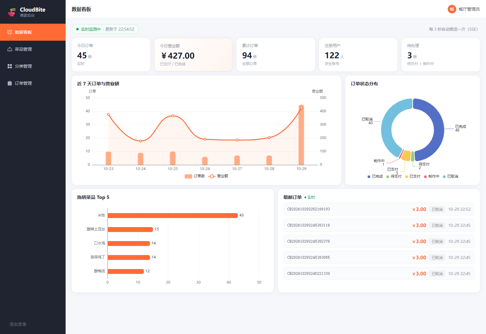
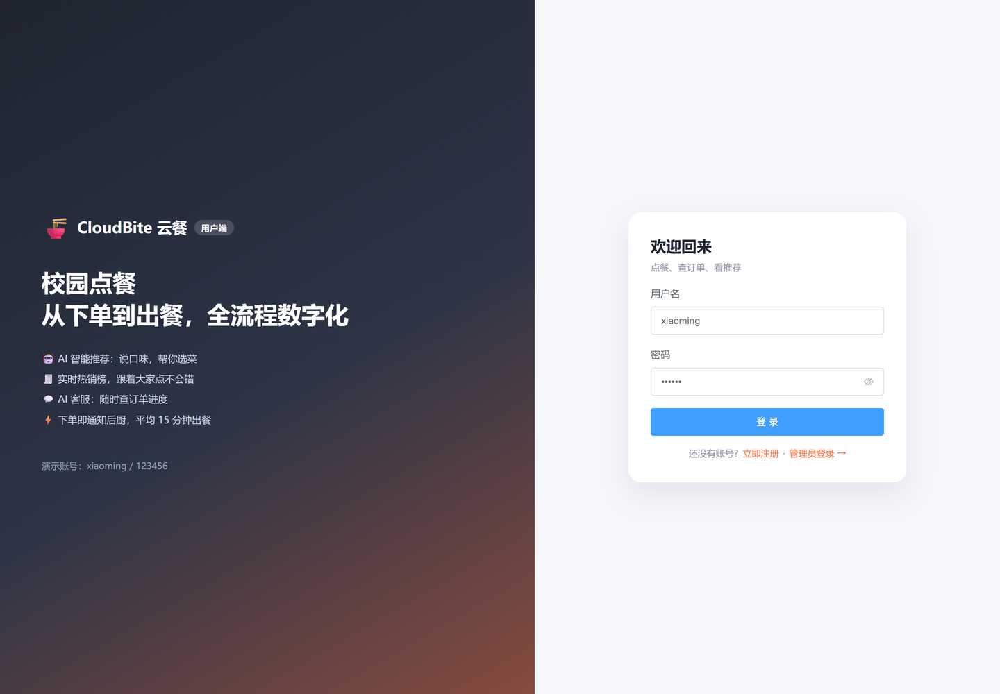
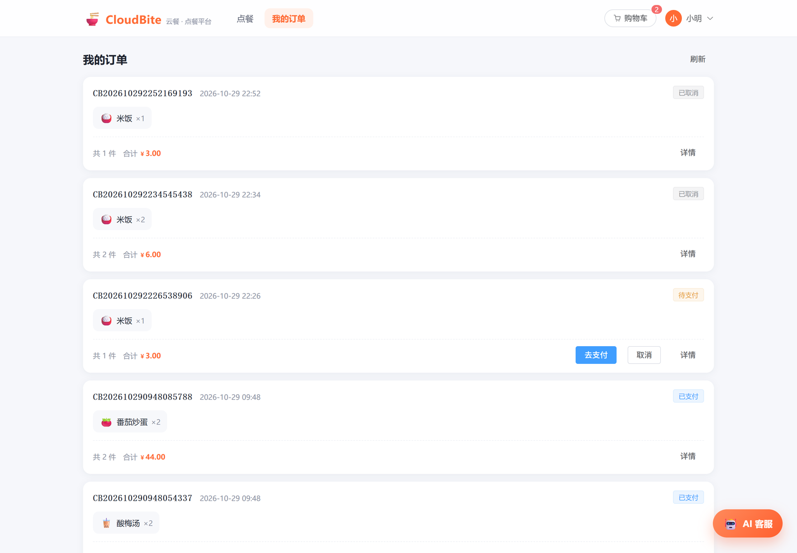
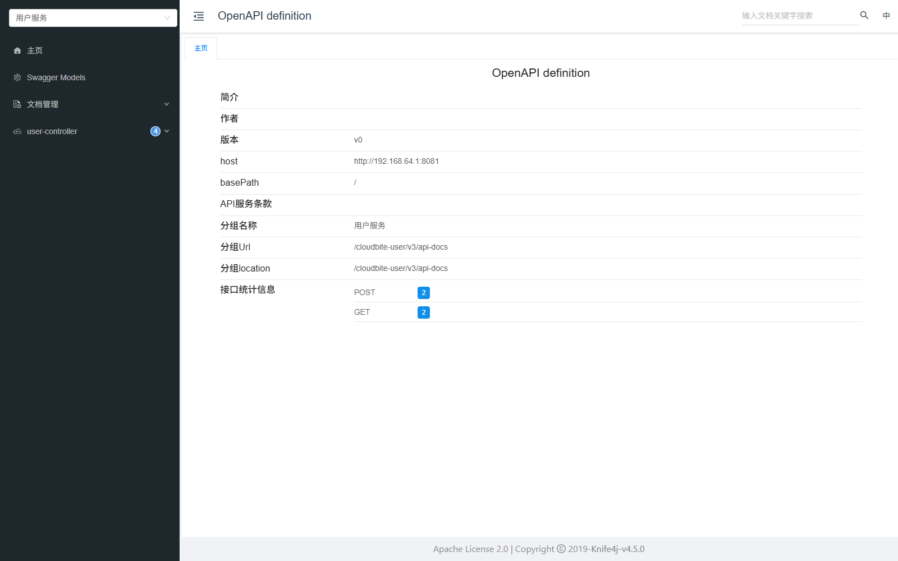
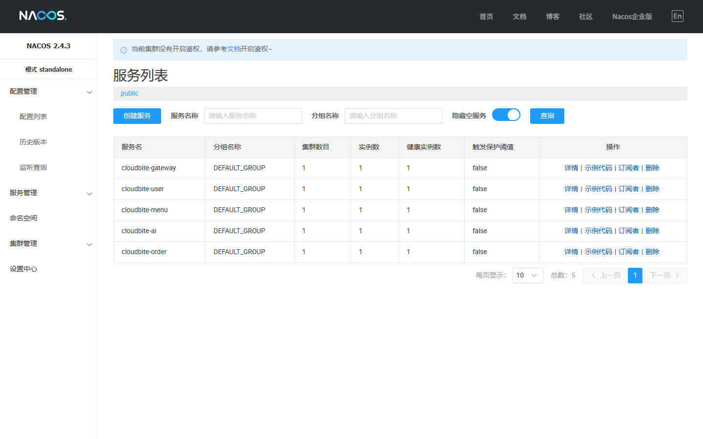

# CloudBite 云餐 · 微服务点餐平台

一个 **前后端分离 + Spring Cloud Alibaba 微服务** 的校园点餐平台，覆盖菜品/分类管理、下单支付、订单状态机、库存扣减、实时经营看板与 AI 推荐。



## 功能一览

| 端 | 功能 |
|---|---|
| 用户端 | 注册登录、菜品浏览、分类筛选、搜索、热销榜、购物车下单、支付/取消、我的订单、AI 菜品推荐与客服 |
| 管理端 | 经营看板（今日订单/营业额/累计/用户数/待处理）、近 7 天趋势、状态分布、热销 Top5、实时订单推送、菜品增删改（含图片上传）、分类管理、订单状态流转 |
| 平台能力 | JWT 鉴权、角色隔离（普通用户访问管理接口返回 403）、接口文档聚合、限流、延迟关单 |

## 界面预览

### 用户端

| 登录 | 点餐首页 |
|---|---|
|  |  |

**点餐首页**：搜索、AI 智能推荐、实时热销榜（Redis ZSET）、分类筛选、菜品卡片（图片上传）、右下角 AI 客服。

| AI 智能推荐 | 购物车 |
|---|---|
|  |  |

| 我的订单 |
|---|
|  |

**我的订单**：按时间倒序，展示菜品明细、金额、状态与操作（去支付 / 取消 / 详情）。

### 管理端

| 经营看板 |
|---|
|  |

**经营看板**：5 个指标卡 + 近 7 天趋势（柱线组合）+ 订单状态环形图 + 热销 Top5 + 最新订单列表，数据通过 **SSE 每 3 秒推送**自动刷新。

## 架构

```
                      ┌──────────────────┐
  Vue 3 (5174)  ───▶  │  Gateway :18080  │  JWT 校验 / 角色鉴权 / 路由
                      └────────┬─────────┘
        ┌──────────────┬───────┴────────┬──────────────┐
   user :8081      menu :8082       order :8083      ai :8084
        │              │                │               │
  cloudbite_user  cloudbite_menu  cloudbite_order  cloudbite_ai
                       ▲                │  Feign
                       └────────────────┘  扣库存 / 回滚 / 查用户数
   Nacos 8848（注册发现 + 配置中心） · Sentinel（限流） · RocketMQ（延迟关单） · Redis（缓存/热销榜/锁）
```

## 技术栈

- **后端**：Spring Boot 3.3.5、JDK 21、Spring Cloud 2023.0.3、Spring Cloud Alibaba 2023.0.3.4
- **微服务**：Nacos（注册/配置）、Spring Cloud Gateway、OpenFeign、Sentinel
- **数据**：MySQL 8、Spring Data JPA、Redis + Redisson
- **消息**：RocketMQ 4.9.7（延迟消息）
- **文档**：Knife4j 4.5.0（网关聚合 OpenAPI）
- **前端**：Vue 3、Vite、Element Plus、Pinia、Vue Router、Axios、ECharts

## 模块说明

| 模块 | 说明 |
|---|---|
| `cloudbite-common` | 公共返回体、异常、JWT 工具、请求头常量 |
| `cloudbite-gateway` | 统一入口：路由、JWT 校验、角色鉴权、文档聚合 |
| `cloudbite-user` | 用户注册登录、用户列表 |
| `cloudbite-menu` | 菜品与分类、库存扣减/回滚、热销榜、图片上传 |
| `cloudbite-order` | 下单、支付、状态机、统计看板、SSE 推送、延迟关单消费 |
| `cloudbite-ai` | DeepSeek 推荐与客服（未配置 Key 时自动降级为规则版） |
| `web` | Vue 3 前端（用户端 + 管理端） |

## 快速开始

### 1. 准备中间件

| 组件 | 版本 | 端口 |
|---|---|---|
| MySQL | 8.0 | 3306 |
| Redis | 5.x+ | 6379 |
| Nacos | 2.4.x（standalone） | 8848 |
| RocketMQ | 4.9.7（NameServer + Broker） | 9876 / 10911 |

数据库会自动创建（JDBC 参数带 `createDatabaseIfNotExist=true`），表结构由 JPA 自动生成。

### 2. 启动后端

```bash
# 编译
mvn -DskipTests clean package

# 依次启动（或使用 start-all.ps1）
java -jar cloudbite-user/target/cloudbite-user-1.0.0.jar
java -jar cloudbite-menu/target/cloudbite-menu-1.0.0.jar
java -jar cloudbite-order/target/cloudbite-order-1.0.0.jar
java -jar cloudbite-ai/target/cloudbite-ai-1.0.0.jar
java -jar cloudbite-gateway/target/cloudbite-gateway-1.0.0.jar
```

环境变量（可选）：

```bash
MYSQL_USER=root
MYSQL_PASSWORD=你的密码
DEEPSEEK_API_KEY=sk-xxx          # 不配置则 AI 降级为规则推荐
JWT_SECRET=自定义密钥
```

### 3. 启动前端

```bash
cd web
npm install
npm run dev      # 默认 5173，代理到 http://localhost:8080
```

微服务网关在 18080 时：

```bash
PORT=5174 PROXY_TARGET=http://127.0.0.1:18080 npm run dev
```

### 4. 访问

| 地址 | 说明 |
|---|---|
| http://localhost:5174 | 前端（用户端 + 管理端） |
| http://localhost:18080/doc.html | Knife4j 聚合接口文档 |
| http://localhost:8848/nacos | Nacos 控制台（nacos/nacos） |

默认账号：`admin / admin123`（管理员）、`xiaoming / 123456`（用户）

## 关键设计

### 1. 库存扣减：锁必须在事务外

```java
// 先抢锁（事务外），再用 TransactionTemplate 开事务
for (StockItem item : sorted) { lock.tryLock("lock:stock:" + dishId, 3); }
transactionTemplate.executeWithoutResult(s -> { /* 校验 + 扣减 */ });
```

如果把锁加在 `@Transactional` 方法内部，事务的 ReadView 会**早于加锁**建立，等锁期间其他事务已提交的扣减不可见，导致并发下**超卖**。

### 2. 延迟消息关单

下单后投递 RocketMQ 延迟消息（生产 30 分钟，演示 10 秒）；到期检查订单状态，未支付则关单并 Feign 调用 `menu` 服务回滚库存。消费端用**条件更新**保证幂等，失败返回 `RECONSUME_LATER` 由 MQ 重试。

### 3. 限流阈值放 Nacos，改完立即生效

`@SentinelResource("createOrder")` + QPS 规则；阈值从 Nacos 配置中心读取，监听刷新事件重新加载，无需重启。

### 4. Redis 的三处用法

- 菜单缓存：版本号失效（写操作 `INCR menu:version`，旧 key 靠 TTL 过期）
- 热销榜：ZSET 按菜品累加销量
- 下单幂等：`SETNX order:submit:{userId}` 3 秒窗口

## 接口文档



网关聚合四个服务的 OpenAPI 文档，一个入口查看/调试全部接口。

## 服务注册



## License

[MIT](LICENSE)
